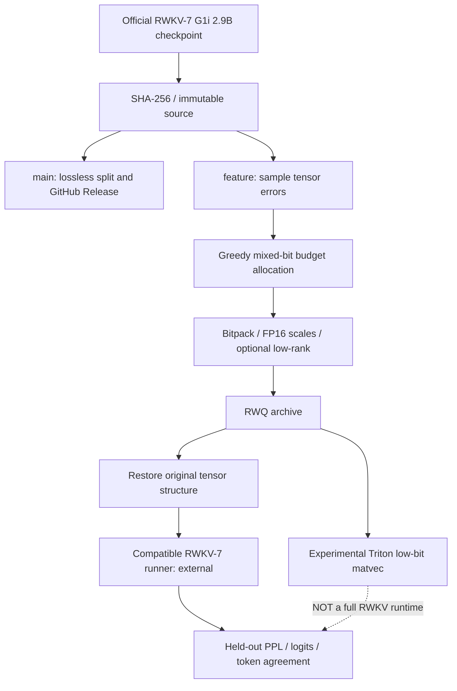
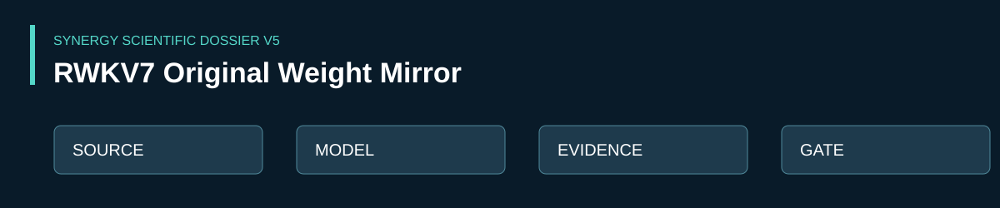

# SYNERGY RWKV-7 — оригинальные веса, экстремальное квантование и проверяемая воспроизводимость

> **Research profile · 24 октября 2026.** Репозиторий объединяет две **разные** исследовательские линии: в `main` — workflow для побайтово точного зеркалирования официальных весов RWKV-7 G1i 2.9B; в ветке `feature/rwkv7-original-weights` — экспериментальный конвертер весов и прототип низкобитного GPU-оператора. Ни наличие workflow, ни существование кода квантования не подтверждают качество модели, запуск полноценного RWKV inference или успешно опубликованный Release.

[Научное досье V5](docs/SCIENTIFIC_DOSSIER_V5_2026.md) · [Исходный checkpoint RWKV](https://huggingface.co/BlinkDL/rwkv7-g1) · [Экспериментальная ветка](https://github.com/Shtenco/synergy_ai_llm_rwkv/tree/feature/rwkv7-original-weights)

## 1. Задача и честный результат

RWKV — семейство рекуррентных языковых архитектур. Цель данного репозитория **не** заявить обучение новой модели, а создать воспроизводимый путь от аутентичного checkpoint к компактному архиву весов, сохранив имена/формы тензоров и измерив цену уменьшения размера в качестве. Дополнительная цель — изучить непосредственное исполнение bitpacked матрично-векторных операций без полной распаковки матриц.

| Контур | Реально обнаруженные артефакты | Статус |
|---|---|---|
| Оригинальные веса | [Workflow main](.github/workflows/rwkv7-g1i-2.9b-original-weights.yml), upstream `BlinkDL/rwkv7-g1` | Определён процесс получения, сегментации, хэширования и публикации; **факт успешного выполнения не проверен** |
| Weight-only конвертер | [`quant.py`](https://github.com/Shtenco/synergy_ai_llm_rwkv/blob/feature/rwkv7-original-weights/rwkv7_extreme_quant_v1/quant.py) | Экспериментальный Python source, **не в main** |
| Аллокатор битности | `allocate` в `quant.py` | Greedy по оценке sampled weight reconstruction MSE, **не** activation-/task-calibrated |
| Восстановление checkpoint | `plan/pack/verify/restore` | Реализованный интерфейс; тесты используют небольшие синтетические матрицы |
| Native CUDA matvec | [`cuda_lowbit.py`](https://github.com/Shtenco/synergy_ai_llm_rwkv/blob/feature/rwkv7-original-weights/rwkv7_extreme_quant_v1/cuda_lowbit.py) | Экспериментальный Triton-код; совместимость и ускорение на конкретной GPU **не подтверждены** |
| End-to-end PPL | [`real_model_eval.py`](https://github.com/Shtenco/synergy_ai_llm_rwkv/blob/feature/rwkv7-original-weights/rwkv7_extreme_quant_v1/real_model_eval.py) | Harness требует внешнего совместимого runner и двух реальных checkpoint; целевой PPL ещё не измерен |

**Никаких утверждений о 700 MB готовой и качественно эквивалентной RWKV-7, о новой SOTA или ускорении inference по этому source-аудиту делать нельзя.**

## 2. Архитектура, данные и границы



Точная граница: существующий `main` **не содержит** Python-пакета `rwkv7_extreme_quant_v1`; исходники находятся в другой ветке и не должны незаметно изображаться кодом `main`.

### Основные вычисления

Для группы исходных весов `w`, `b ∈ {1,2,3,4,8}` и масштаба `s` симметричное midrise квантование в экспериментальном `quant.py` задаётся приближённо как

$$
q_i = \operatorname{clip}\left(\operatorname{round}\left(w_i/s+(2^b-1)/2\right),0,2^b-1\right),
\qquad
\hat w_i=s\left(q_i-(2^b-1)/2\right).
$$

`qgroup` перебирает конечный набор множителей scale и минимизирует MSE **весов**. Для каждой матрицы `sensitivity` получает выборочную нормированную ошибку

$$
e_b(W) = \frac{\operatorname{MSE}(W_{\mathrm{sample}},\hat W_{\mathrm{sample},b})}{\operatorname{mean}(W_{\mathrm{sample}}^2)+10^{-12}}.
$$

Затем `allocate` повышает битность по убывающей оценке прироста качества на дополнительный байт; этот greedy-выбор не решает глобальную дискретную оптимизацию и не использует настоящие активации модели. Для некоторых матриц допускается дополнение `W≈Q_b(W-LR)+LR` с низкоранговыми FP16-факторами `L,R`. Дополнительная память, стоимость чтения и runtime-латентность обязаны учитываться вместе с экономией объёма.

### Бюджет хранения ≠ память инференса

Архив ограничивается **700 000 000 байт** только при успешном `pack` и проверке фактического размера. Это не гарантирует ни VRAM ≤700 MB, ни допустимый runtime KV/recurrent state/activations, ни throughput. Команда `restore` восстанавливает крупный checkpoint, а `.rwq` не является drop-in форматом для существующих RWKV-runners.

## 3. Как воспроизвести

### A. Контроль оригинальных весов (main)

1. Открыть [GitHub Actions workflow](.github/workflows/rwkv7-g1i-2.9b-original-weights.yml) и выполнить вручную в среде с разрешёнными GitHub Releases.
2. Workflow загружает `rwkv7-g1i-2.9b-20260805-ctx16384.pth` из `BlinkDL/rwkv7-g1`, разбивает на части не более `1500*1024*1024` байт и публикует `PARTS_SHA256SUMS`, `ORIGINAL_SHA256SUMS` и инструкцию восстановления.
3. После **фактически успешного** run скачать все части, восстановить побайтно и проверить digest.

```bash
cat rwkv7-g1i-2.9b-20260805-ctx16384.pth.part-* > rwkv7-g1i-2.9b-20260805-ctx16384.pth
sha256sum -c ORIGINAL_SHA256SUMS
```

Проверить также контрольные суммы отдельных частей и наличие полноценного GitHub Release. Source-код workflow **не доказывает**, что релиз или веса уже существуют. Требуется отдельная проверка прав на перераспространение оригинальных весов.

### B. Тесты исследовательского конвертера (feature branch)

```bash
git clone https://github.com/Shtenco/synergy_ai_llm_rwkv.git
cd synergy_ai_llm_rwkv
git switch feature/rwkv7-original-weights
cd rwkv7_extreme_quant_v1
python -m pip install numpy 'torch>=2.5'
python -m unittest discover -s tests -v
```

Наличие исходных unit-тестов означает лишь покрытие **синтетических входов**: `pack_codes/unpack_codes` для 1/2/3/4/8 бит, shape/MSE, бюджет аллокатора и маленький checkpoint pipeline. Здесь не фиксируется новый независимый результат запуска.

При наличии настоящего checkpoint:

```bash
python quant.py plan --checkpoint model.pth --out plan.json --budget-mb 700 --group-size 256 --sample 8192 --residual-rank 4
python quant.py pack --checkpoint model.pth --plan plan.json --out model-700mb.rwq
python quant.py verify --checkpoint model.pth --archive model-700mb.rwq --out reconstruction.json
python quant.py restore --archive model-700mb.rwq --out restored-fp16.pth
```

Для GPU-оператора — только при наличии NVIDIA/CUDA, совместимых PyTorch и Triton:

```bash
python -m pip install triton
python cuda_lowbit.py --selftest
```

Не публиковать `PASS`, если этот selftest реально не исполнялся на заявленной GPU.

## 4. Независимый протокол принятия

| Метрика | Контроль | Правило утверждения |
|---|---|---|
| Подлинность | Upstream SHA-256 и SHA-256 восстановленного файла | Побайтовое равенство |
| Disk size | `stat` итогового архива + manifest | ≤700 000 000 B лишь если сборка завершилась |
| Tensor fidelity | Совпадение имён, форм и finite reconstructed values | Отдельно от task quality |
| Perplexity | Held-out teacher/quant logits, общие token IDs/labels | Проверить отношение PPL; `≤1.05` — **цель, не результат** |
| Top-1 agreement | Доля совпадений следующего токена | Фиксировать на тех же примерах |
| Скорость | Same GPU, sequence length, batch size, warmup, end-to-end token/s | Против исходного RWKV runner, не только отдельного matvec |
| Память | Peak CPU RAM и peak GPU VRAM | Не путать с дисковым архивом |
| Long context | 1K/4K/16K с контролем state drift | Нельзя заменить маленькими весовыми тестами |

Отрицательный контроль: модель с неверным checkpoint SHA, переставленными token labels, пропущенной матрицей или невалидными scales **не должна** успешно проходить quality/provenance gate.

## 5. Риски, непройденные рубежи и научная новизна

- **Реальная новизна исследовательского прототипа:** контролируемое mixed-bit packing по роли матриц, бюджетная упаковка с учётом шкал/метаданных, факультативные low-rank factors и прямой bitpacked matvec.
- **Не доказано:** успешное уплотнение полного G1i 2.9B до 700 MB с заданным качеством; ускорение автогенерации; конкурентоспособность с современными квантователями; безопасная публикация официальных весов по условиям upstream.
- **Проверить прежде всего:** `torch.load` на BF16 и сторонних checkpoints, поведение streaming archive, memory peak, корректность scales, throughput GPU, лицензии, криптографическую фиксацию inputs/outputs.
- **Критерий GREEN:** воспроизводимый полный checkpoint + реальный фиксированный holdout + raw metrics + отрицательные контроли + artifact hashes + CI/hardware evidence, а не привлекательная цифра компрессии.

## 6. Навигация

- [Workflow оригинальных весов](.github/workflows/rwkv7-g1i-2.9b-original-weights.yml)
- [README экспериментального квантования](https://github.com/Shtenco/synergy_ai_llm_rwkv/blob/feature/rwkv7-original-weights/rwkv7_extreme_quant_v1/README.md)
- [Исходники квантования](https://github.com/Shtenco/synergy_ai_llm_rwkv/tree/feature/rwkv7-original-weights/rwkv7_extreme_quant_v1)
- [Тесты квантования](https://github.com/Shtenco/synergy_ai_llm_rwkv/tree/feature/rwkv7-original-weights/rwkv7_extreme_quant_v1/tests)
- [Научное досье V5](docs/SCIENTIFIC_DOSSIER_V5_2026.md)
- [Системный стандарт SYNERGY](https://github.com/Shtenco/synergy_system)

---

## Исторический README (сохранён без удаления)

<!-- SCIENTIFIC-V5-2026:START -->


**[Научное досье V5](docs/SCIENTIFIC_DOSSIER_V5_2026.md)** — source inventory, acceptance gates, ограничения и проверки. **Статус:** WORKFLOW ONLY. Исторический текст README сохранён ниже.

<!-- SCIENTIFIC-V5-2026:END -->

# synergy_ai_llm_rwkv
