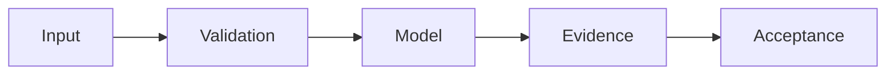

# RWKV7 Original Weight Mirror — SCIENTIFIC DOSSIER V5

**Дата:** 24.10.2026. **Статус:** WORKFLOW ONLY.

> Научно-технический source audit. Наличие кода, документации, тестов или workflow не означает фактического запуска, подтверждённой доходности или production readiness.

## Проблема и метод

GitHub Actions зеркалирует исходные веса, а не реализует архитектуру RWKV.

## Проверенные исходники

- [.github/workflows/rwkv7-g1i-2.9b-original-weights.yml](../.github/workflows/rwkv7-g1i-2.9b-original-weights.yml)
- [README.md](../README.md)

## Формализация и проверка

Общее требование: отчёты должны связывать claim с commit SHA, данными, тестовыми параметрами и наблюдаемым raw output. 

**Acceptance:** SHA256 оригинала и всех частей, крайние случаи splitting, подтверждённые release artifacts, лицензирование.

## Ограничения и отрицательные результаты

Нет model source, inference implementation, training pipeline или подтверждённой успешной загрузки.

## Дальнейший инженерный план

1. Проверить версии зависимостей и воспроизводимость команд тестирования.
2. Добавить negative/adversarial controls, документировать failed-case.
3. Зафиксировать фактический CI verdict и привязанный SHA; не повышать зрелость из одного факта существования workflow.
4. Поддерживать границу между R&D, CANDIDATE и DEPLOYED.

Оформление по научному профилю [dlp_solver](https://github.com/Shtenco/dlp_solver) и [synergy_system](https://github.com/Shtenco/synergy_system). Исходный README сохранён.
